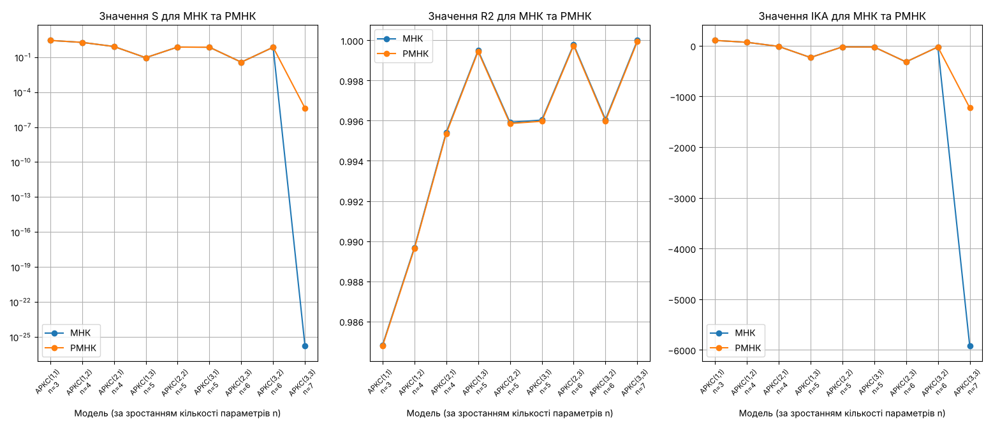
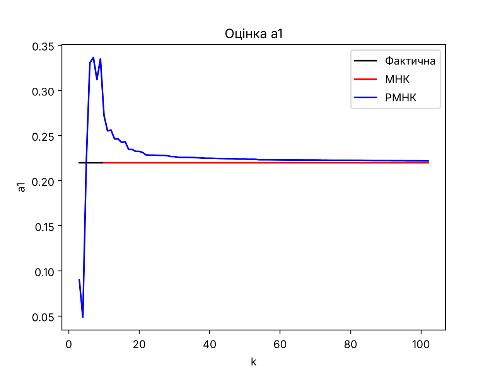
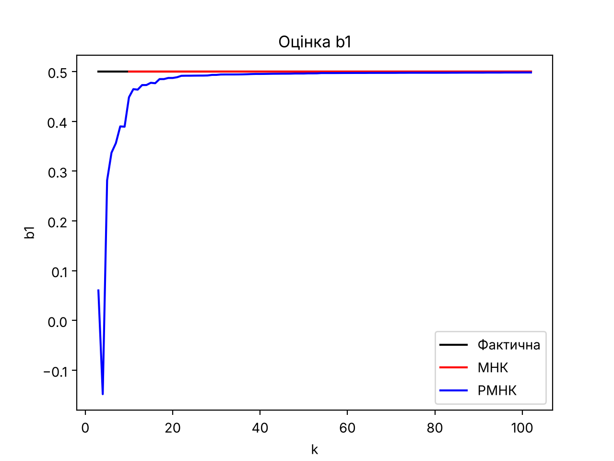

# Лабораторна робота №1. Оцінювання параметрів АРКС(p,q) методами МНК і РМНК

**Дисципліна:** Аналіз часових рядів (АЧР)
**Заклад:** КПІ ім. Ігоря Сікорського, ННІ прикладного системного аналізу, кафедра ММСА
**Групи:** КА-33, КА-32 · **Бригада:** №1 · **Рік:** 2026
**Виконали:** Сивенко Костянтин, Слюсар Олександр, Тодощенко Євгеній


-2ea44f)

---

## Мета

Навчитися оцінювати параметри різницевого рівняння авторегресії з ковзним середнім (АРКС) заданого порядку за допомогою методу найменших квадратів (МНК) та рекурсивного МНК (РМНК), визначити кращий метод оцінювання та за статистичними критеріями обрати «найкращу» модель процесу.

## Об'єкт (бригада №1)

```
y(k) = 0 + 0,22·y(k−1) − 0,18·y(k−2) + 0,08·y(k−3) + v(k) + 0,5·v(k−1) + 0,25·v(k−2) + 0,25·v(k−3)
θ = (a0, a1, a2, a3, 1, b1, b2, b3)ᵀ = (0; 0,22; −0,18; 0,08; 1; 0,5; 0,25; 0,25)ᵀ
```

- Умова стійкості: |a1| + |a2| + |a3| = 0,48 < 1.
- v(k) — білий шум (сума 12 рівномірних U[0;1] мінус 6), зерно генератора 2024.
- Об'єм вибірки N = 100 (k = 3…102), спільний для всіх моделей.
- МНК: θ = (XᵀX)⁻¹XᵀY; РМНК: θ(0) = 0, P(0) = 300·I.

## Результати

| Модель | S (МНК) | R² (МНК) | IKA (МНК) | S (РМНК) | R² (РМНК) | IKA (РМНК) |
|---|---:|---:|---:|---:|---:|---:|
| АРКС(1,1) | 2,722 | 0,9848 | 106,1 | 2,722 | 0,9848 | 106,1 |
| АРКС(1,2) | 1,850 | 0,9897 | 69,5 | 1,850 | 0,9896 | 69,5 |
| АРКС(1,3) | 0,0898 | 0,9995 | −231,1 | 0,0898 | 0,9995 | −231,1 |
| АРКС(2,1) | 0,8206 | 0,9954 | −11,8 | 0,8206 | 0,9954 | −11,8 |
| АРКС(2,2) | 0,7320 | 0,9959 | −21,2 | 0,7320 | 0,9959 | −21,2 |
| АРКС(2,3) | 0,0369 | 0,9998 | −318,0 | 0,0369 | 0,9997 | −318,0 |
| АРКС(3,1) | 0,7116 | 0,9960 | −24,0 | 0,7116 | 0,9960 | −24,0 |
| АРКС(3,2) | 0,7068 | 0,9961 | −22,7 | 0,7068 | 0,9960 | −22,7 |
| **АРКС(3,3)** | **1,19·10⁻²⁶** | **1,0000** | **−5955,3** | **4,21·10⁻⁶** | **0,9999** | **−1223,8** |

### Критерії якості


### Перехідні процеси оцінок (АРКС(3,3))

| a1 | b1 |
|---|---|
|  |  |

Графіки для всіх коефіцієнтів (a0…a3, b1…b3, коефіцієнт при v(k)) — у папці [`outputs/`](outputs).

## Висновки

- За всіма критеріями (S, R², IKA) найкраща модель — **АРКС(3,3)**, що збігається з порядком об'єкта; серед неповних моделей найкраща АРКС(2,3) (IKA = −318,0).
- **МНК** точно відновлює параметри (S ≈ 1,19·10⁻²⁶), оскільки дані не містять додаткового шуму вимірювань.
- **РМНК** після перехідного процесу (≈ 20–25 кроків) наближається до точних значень: S = 4,21·10⁻⁶, найбільше відхилення оцінок 0,0021.
- На практиці перевагу має РМНК: не потребує обернення матриці (яка може бути виродженою) і обробляє дані послідовно, по мірі надходження.

## Структура

```
лаб1/
├── code/       # lab1.py — генерація даних, МНК, РМНК, критерії, графіки
├── outputs/    # графіки перехідних процесів та критеріїв
└── protocol/   # протокол лабораторної роботи (.pdf)
```

## Запуск

```bash
cd code
pip install -r requirements.txt
python lab1.py                                                   # повна лабораторна (бригада №1)
python lab1.py --p 2 --q 1 --coeffs 0 0.22 -0.18 0.08 0.5 0.25 0.25   # власний об'єкт
python lab1.py --v-file v.txt --y-file y.txt --coef-file test.txt     # тестові дані з файлів
```

📄 **Протокол:** [protocol/АЧР_ЛР1_протокол.pdf](protocol/АЧР_ЛР1_протокол.pdf)
