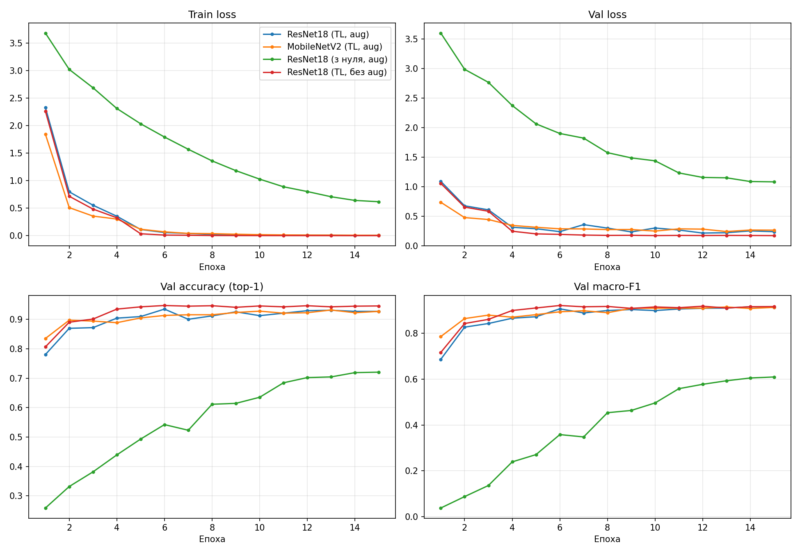
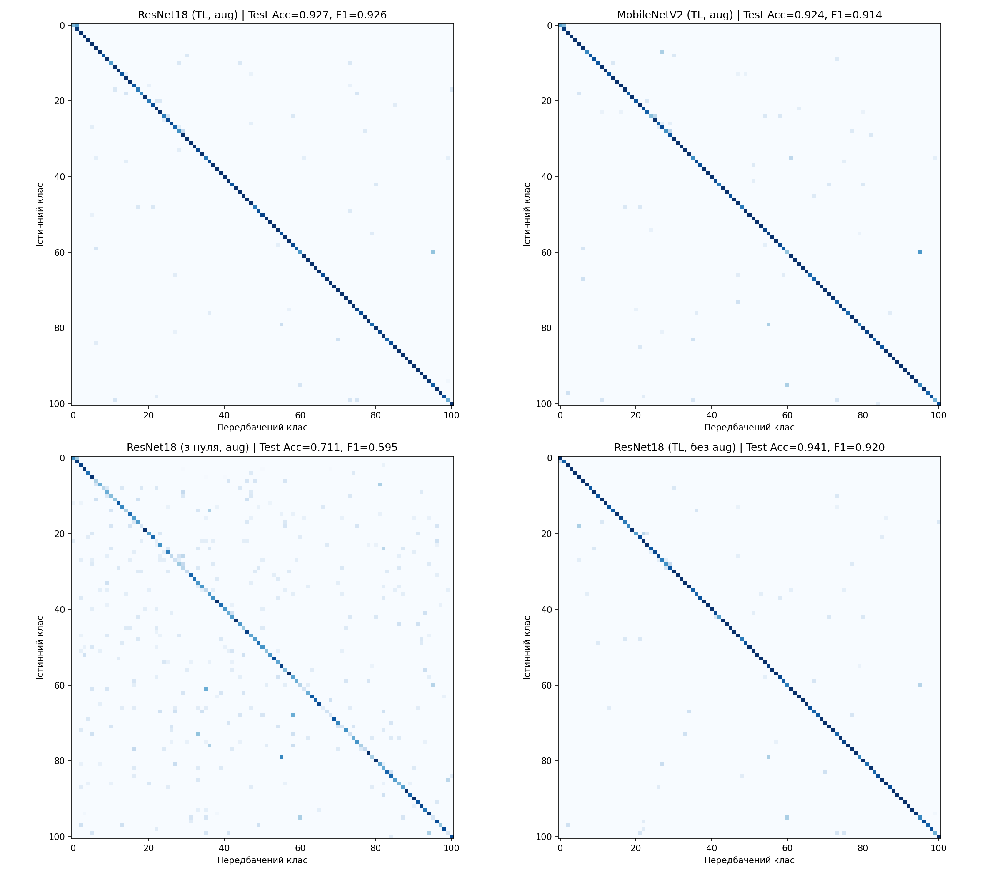
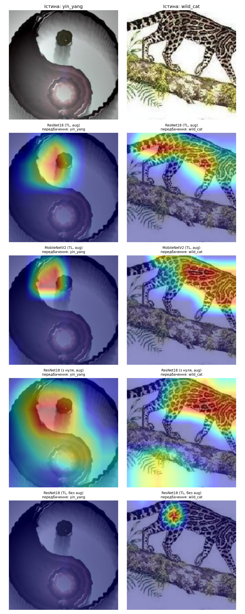
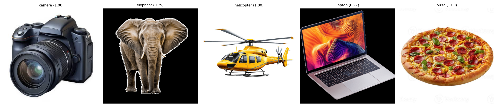

# Лабораторна робота №1. Згорткові нейронні мережі (класифікація зображень)

**Дисципліна:** Основи моделювання складних мереж (ОМСМ)
**Заклад:** КПІ ім. Ігоря Сікорського, ННІ прикладного системного аналізу, кафедра ММСА
**Група:** КА-33 · **Варіант:** 13 · **Рік:** 2026
**Виконали:** Тодощенко Євгеній, Сивенко Костянтин, Слюсар Олександр


---

## Мета

Навчити CNN для мультикласової класифікації, порівняти щонайменше дві архітектури та підходи «з нуля» vs transfer learning, оцінити якість (Accuracy, F1, Confusion Matrix) і вплив аугментацій.

## Дані та методика

- **Датасет:** Caltech-101 (101 клас, без `BACKGROUND_Google`), стратифікований поділ 70 / 15 / 15.
- **Архітектури:** ResNet18 і MobileNetV2 (torchvision).
- **Навчання:** 15 епох, AdamW, CosineAnnealingLR; для transfer learning — перші 3 епохи навчається лише «голова», далі розморожується вся мережа.
- **Аугментації:** RandomResizedCrop, RandomHorizontalFlip, ColorJitter.
- **Обладнання:** GPU AMD через `torch-directml`.

## Результати

| Модель | Параметри (М) | FLOPs (Г) | Latency CPU (мс) | Test Acc | Test Top-5 | Test Macro-F1 |
|---|---:|---:|---:|---:|---:|---:|
| ResNet18 (TL, aug) | 11.23 | 1.81 | 15.1 | 92.7 % | 99.2 % | **0.926** |
| MobileNetV2 (TL, aug) | 2.35 | 0.30 | 13.7 | 92.4 % | 99.5 % | 0.914 |
| ResNet18 (з нуля, aug) | 11.23 | 1.81 | 15.4 | 71.1 % | 89.3 % | 0.595 |
| ResNet18 (TL, без aug) | 11.23 | 1.81 | 15.0 | **94.1 %** | 99.4 % | 0.920 |

### Криві навчання


### Матриці помилок


### Grad-CAM


### Інференс на власних зображеннях


## Висновки

- **Transfer learning vs з нуля (ResNet18):** Acc 92.7 % проти 71.1 % (+21.6 п.п.), Macro-F1 0.926 проти 0.595 — попереднє навчання на ImageNet дає вирішальну перевагу на невеликому датасеті.
- **Вплив аугментацій (ResNet18 TL):** без аугментацій Acc вища (94.1 % проти 92.7 %), але Macro-F1 нижча (0.920 проти 0.926), тобто аугментації покращують якість на рідкісних класах.
- **ResNet18 vs MobileNetV2 (TL):** за майже однакової точності (92.7 % проти 92.4 %) MobileNetV2 має у 4.8 раза менше параметрів і у 6 разів менше FLOPs.
- **Найкраща модель за Test Macro-F1:** ResNet18 (TL, aug).
- **Типові помилки:** схожі класи (Faces_easy → Faces, lotus ↔ water_lilly, schooner → ketch).

## Структура

```
лаб1/
├── code/        # ОМСМ_лаба1.py — навчання та оцінка, run_inference.py — інференс
├── outputs/     # таблиця порівняння, історії навчання, графіки
├── my_images/   # власні зображення для інференсу
└── protocol/    # протокол лабораторної роботи (.docx)
```

## Запуск

```bash
cd code
pip install -r requirements.txt
python ОМСМ_лаба1.py      # навчання та оцінка (датасет завантажиться автоматично)
python run_inference.py   # класифікація зображень з my_images/
```

> Ваги моделей (`*.pt`) і датасет не додано до репозиторію через великий розмір.

📄 **Протокол:** [protocol/ОМСМ_ЛР1_протокол.docx](protocol/ОМСМ_ЛР1_протокол.docx)
