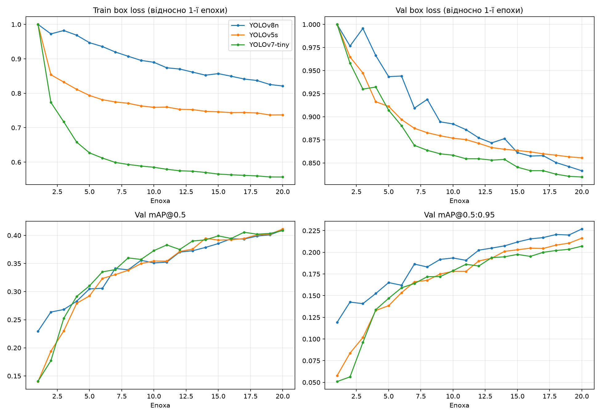
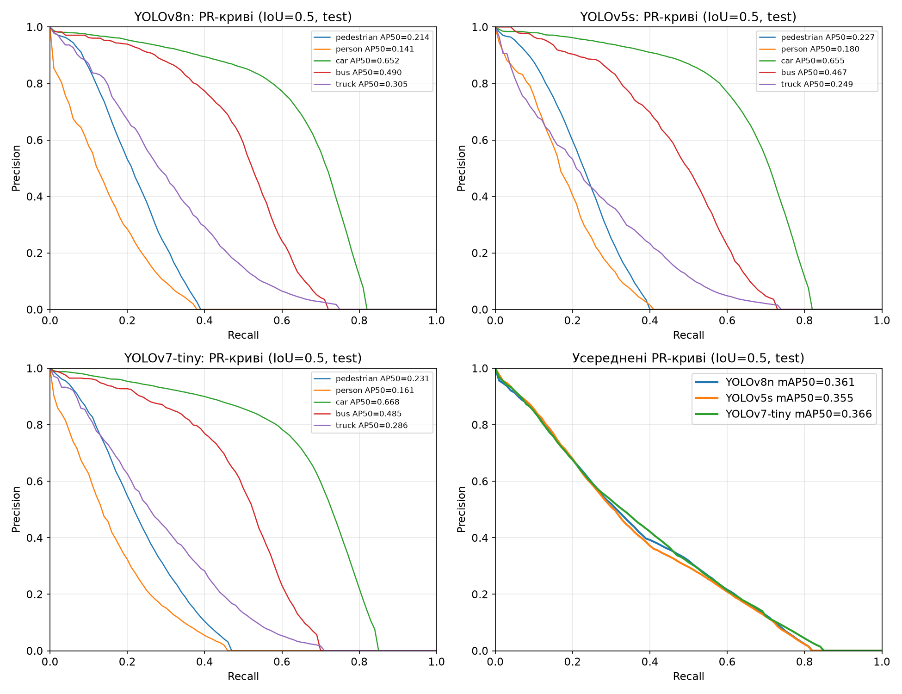
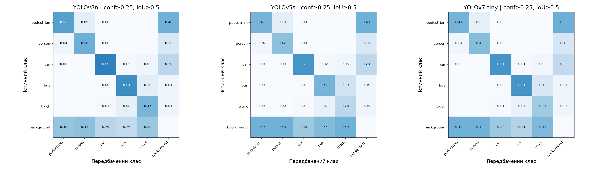
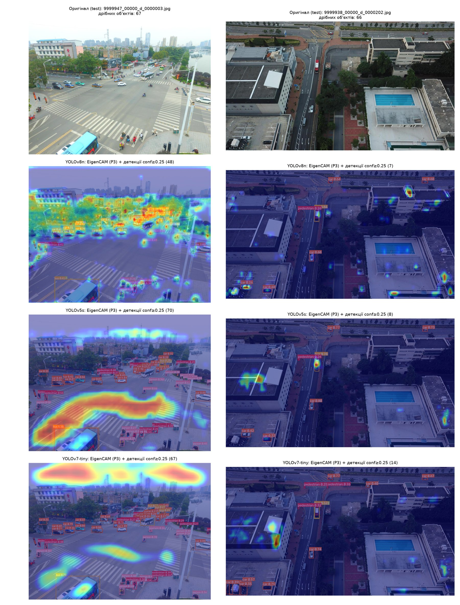
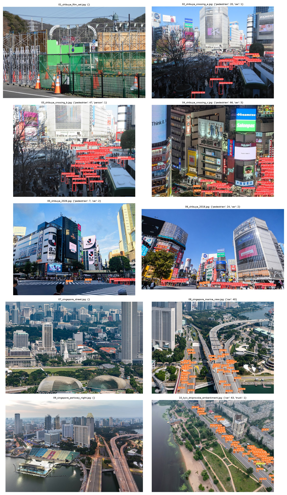
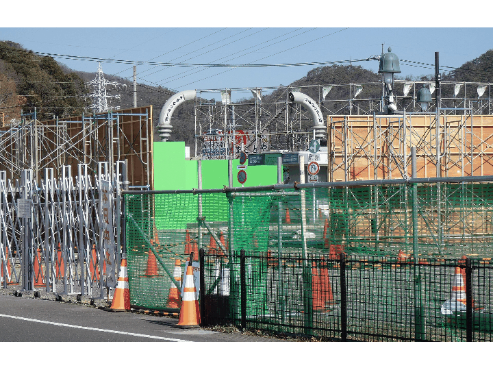

# Лабораторна робота №2. Детекція об’єктів з YOLO

**Дисципліна:** Основи моделювання складних мереж (ОМСМ)
**Заклад:** КПІ ім. Ігоря Сікорського, ННІ прикладного системного аналізу, кафедра ММСА
**Група:** КА-33 · **Варіант:** 13 · **Рік:** 2026
**Виконали:** Тодощенко Євгеній, Сивенко Костянтин, Слюсар Олександр


---

## Мета

Підготувати дані у форматі YOLO, навчити щонайменше дві архітектури YOLO, порівняти їх якість (mAP@0.5, mAP@0.5:0.95) і швидкодію (параметри, FLOPs, FPS/latency, розмір ваг), виконати інференс на власних зображеннях.

**Варіант 13:** VisDrone (аерозйомка з дронів), класи `pedestrian / person / car / bus / truck`, обов’язкове порівняння **yolov8n vs yolov5s**, фокус — **дрібні об’єкти** (67,9 % рамок test-dev < 32² пікс.).

## Дані та методика

- **Датасет:** VisDrone2019-DET — 6471 train / 548 val / 1610 test-dev; ignored regions замасковано, val — для вибору епохи й тюнінгу, test-dev — лише фінальна оцінка.
- **Моделі:** YOLOv8n (Ultralytics), YOLOv5s (офіційний репозиторій ultralytics/yolov5), YOLOv7-tiny (офіційний WongKinYiu/yolov7) — усі з COCO-ваг.
- **Однакові умови:** imgsz 640, batch 16, 20 епох, SGD lr0 0,01, однакові аугментації (Mosaic, HSV, translate, scale, flip), seed 0.
- **Єдиний оцінювач:** однаковий letterbox + multi-label NMS (conf 0,001, IoU 0,6, ≤1000 дет./кадр) + COCOeval для всіх моделей.
- **Обладнання:** AMD Radeon RX 9060 XT 16 ГБ (PyTorch 2.14 + ROCm 10.1 на Windows 11), Visual Studio 2026.

## Результати (test-dev)

| Модель | imgsz | Параметри (М) | FLOPs (Г) | mAP@0.5 | mAP@0.5:0.95 | AP_small | FPS (GPU) | FPS (CPU) | Ваги (МБ) |
|---|---:|---:|---:|---:|---:|---:|---:|---:|---:|
| **YOLOv8n** | 640 | **3.13** | **8.6** | 0.361 | **0.204** | 0.077 | 67.9 | **2.7** | **6.2** |
| YOLOv5s | 640 | 7.02 | 15.8 | 0.355 | 0.183 | **0.082** | 71.3 | 1.4 | 13.7 |
| YOLOv7-tiny | 640 | 6.02 | 13.1 | **0.366** | 0.190 | 0.077 | **74.1** | 1.8 | 11.7 |

### Дрібні об’єкти: роздільна здатність і SAHI (YOLOv8n)

| Режим | mAP@0.5:0.95 | AP_small | FPS (CPU) |
|---|---:|---:|---:|
| imgsz 640 | 0.204 | 0.077 | 2.7 |
| imgsz 960 (лише інференс) | **0.249** | 0.120 | 1.7 |
| SAHI (тайли 640, перекриття 20 %) | 0.242 | **0.129** | 0.5 |

### Бонусні абляції YOLOv8n (30 % train, 20 епох)

| Варіант | mAP@0.5:0.95 | Δ, п.п. |
|---|---:|---:|
| База | 0.172 | — |
| Без аугментацій | 0.127 | −4.4 |
| Cosine LR | 0.174 | +0.3 |
| MixUp + CutMix | 0.174 | +0.2 |
| Freeze → unfreeze | 0.172 | +0.0 |

Додатково: тюнінг lr0 (найкраще 0,02), порогу IoU NMS (0,6) і conf (0,3 за F1), візуалізація EigenCAM.

### Криві навчання


### PR-криві та матриці плутанини



### EigenCAM


### Інференс на власних зображеннях




## Висновки

- **YOLOv8n — найкраща за mAP@0.5:0.95 (0,204)** і водночас найлегша: у 2,2 раза менше параметрів і в 1,8 раза менше FLOPs, ніж YOLOv5s, ваги 6,2 МБ проти 13,7 МБ; перевага — у точнішій локалізації (AP@0.75 0,206 проти 0,172).
- **Дрібні об’єкти — головна проблема варіанта:** AP_small усіх моделей ≈ 0,08; найгірші класи — `person` і `pedestrian`. Інференс при 960 пікс. дає +4,5 п.п. mAP@0.5:0.95, SAHI — +5,2 п.п. AP_small ціною швидкодії.
- **Аугментації критично важливі:** без них −4,4 п.п. через перенавчання; Cosine LR, MixUp + CutMix і freeze → unfreeze на 20 епохах — у межах ±0,3 п.п.
- **На власних знімках** модель добре працює на дронових ракурсах (до 66 пішоходів і 63 авто на кадр), але погано — з рівня вулиці, у сутінках і з дуже великої висоти.

## Структура

```
лаб2/
├── code/        # ОМСМ_лаба2.py — увесь конвеєр, yolo_common.py — спільний інференс/NMS/SAHI,
│                # run_inference.py — інференс, setup_env.bat / run_lab.bat — середовище та запуск
├── outputs/     # таблиці (CSV), графіки, EigenCAM, GIF із детекціями, висновки
├── my_images/   # власні зображення (джерела й ліцензії — SOURCES.md)
└── protocol/    # протокол лабораторної роботи (.docx)
```

## Запуск

```bat
cd code
setup_env.bat    :: Python 3.12 + PyTorch для ROCm (AMD) + залежності
run_lab.bat      :: дані → навчання → оцінка → бонуси → інференс (або F5 у Visual Studio)
```

Для NVIDIA/CPU встановіть PyTorch відповідної збірки і виконайте `pip install -r requirements.txt`, `python ОМСМ_лаба2.py`.

> Датасет VisDrone, офіційні репозиторії YOLOv5/YOLOv7 та ваги завантажуються автоматично; ваги моделей (`*.pt`) і датасет не додано до репозиторію через великий розмір.

📄 **Протокол:** [protocol/ОМСМ_ЛР2_протокол.docx](protocol/ОМСМ_ЛР2_протокол.docx)
