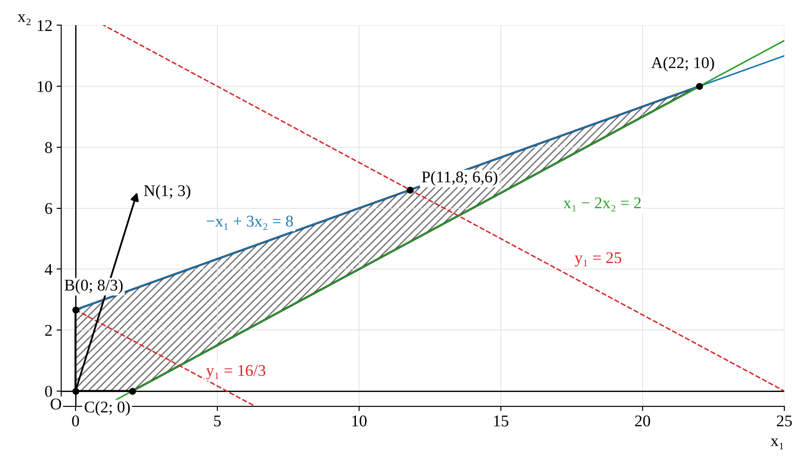
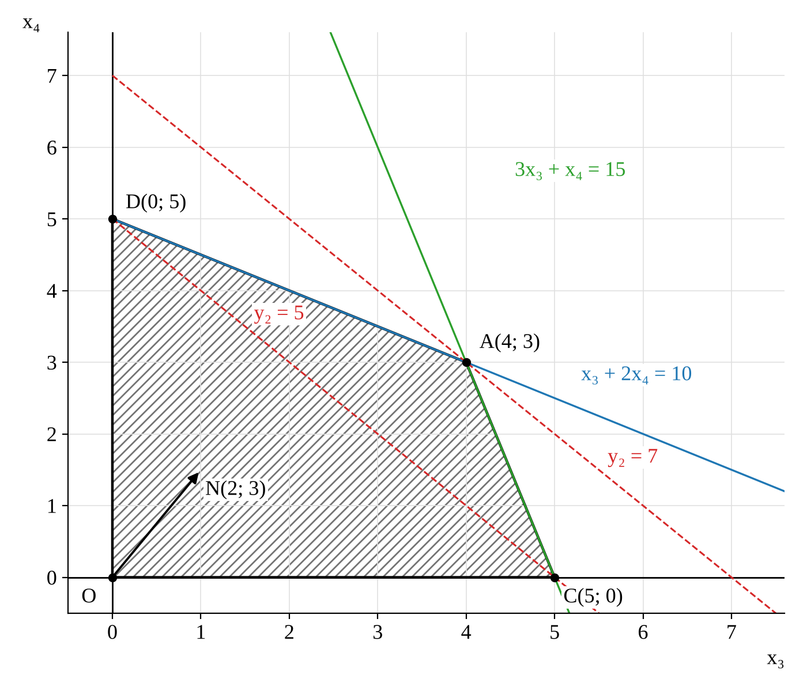

# Контрольна робота №2. Метод декомпозиції Корнаї–Ліптака

**Дисципліна:** Теорія прийняття рішень (ТПР)
**Заклад:** КПІ ім. Ігоря Сікорського, ННІ прикладного системного аналізу
**Група:** КА-33 · **Задача:** 8.14 · **Рік:** 2026
**Виконав:** Слюсар Олександр


---

## Умова

```
F = x1 + 3x2 + 2x3 + 3x4 → max

x1 + 2x2 + x3 + x4 ≤ 30            (зв'язуюче обмеження, b0 = 30)

Блок 1:  −x1 + 3x2 ≤ 8             Блок 2:  x3 + 2x4 ≤ 10
          x1 − 2x2 ≤ 2                      3x3 + x4 ≤ 15

xj ≥ 0, j = 1…4
```

## Розв'язання

Ідея методу — розподіл спільного ресурсу між підсистемами: кожен блок отримує частку ресурсу yj, причому y1 + y2 ≤ 30. Для кожного блоку розв'язується параметрична задача ЛП, оптимальне значення якої fj(yj) є кусково-лінійною функцією виділеного ресурсу.

### 1. Блочна задача 1

```
max(x1 + 3x2) = f1(y1)

x1 + 2x2 ≤ y1,   −x1 + 3x2 ≤ 8,   x1 − 2x2 ≤ 2,   x1, x2 ≥ 0
```

Вершини області: O(0; 0), C(2; 0), A(22; 10), B(0; 8/3).



- 0 ≤ y1 ≤ 16/3: максимум на осі x2 (одиниця ресурсу дає x2 приріст 3/2, а x1 лише 1), x1 = 0, x2 = y1/2.
- 16/3 ≤ y1 ≤ 42: максимум на перетині x1 + 2x2 = y1 та −x1 + 3x2 = 8, звідки x1 = (3y1 − 16)/5, x2 = (y1 + 8)/5.
- y1 ≥ 42: досягнуто вершину A(22; 10), подальший ресурс не використовується.

```
f1(y1) = 3y1/2,          0 ≤ y1 ≤ 16/3
f1(y1) = (6y1 + 8)/5,    16/3 ≤ y1 ≤ 42
f1(y1) = 52,             y1 ≥ 42
```

### 2. Блочна задача 2

```
max(2x3 + 3x4) = f2(y2)

x3 + x4 ≤ y2,   x3 + 2x4 ≤ 10,   3x3 + x4 ≤ 15,   x3, x4 ≥ 0
```

Вершини області: O(0; 0), C(5; 0), A(4; 3), D(0; 5).



- 0 ≤ y2 ≤ 5: максимум на осі x4, x3 = 0, x4 = y2.
- 5 ≤ y2 ≤ 7: максимум на прямій x3 + 2x4 = 10, звідки x3 = 2y2 − 10, x4 = 10 − y2.
- y2 ≥ 7: досягнуто вершину A(4; 3).

```
f2(y2) = 3y2,        0 ≤ y2 ≤ 5
f2(y2) = y2 + 10,    5 ≤ y2 ≤ 7
f2(y2) = 17,         y2 ≥ 7
```

### 3. Координуюча задача

max(f1(y1) + f2(y2)) при y1 + y2 ≤ 30. Ресурс розподіляється за граничною ефективністю dfj/dyj:

| Крок | df1/dy1 | df2/dy2 | Рішення |
|---|---|---|---|
| 1 | 3/2 (0 ≤ y1 ≤ 16/3) | 3 (0 ≤ y2 ≤ 5) | блок 2 отримує y2 = 5 |
| 2 | 3/2 (0 ≤ y1 ≤ 16/3) | 1 (5 ≤ y2 ≤ 7) | блок 1 отримує y1 = 16/3 |
| 3 | 6/5 (16/3 ≤ y1 ≤ 42) | 1 (5 ≤ y2 ≤ 7) | блок 1 отримує весь залишок: y1 = 25 |

Оптимальний розподіл ресурсу: **y1 = 25, y2 = 5**.

## Відповідь

**x\* = (59/5; 33/5; 0; 5) = (11,8; 6,6; 0; 5), F_max = 233/5 = 46,6**

Перевірка: зв'язуюче обмеження виконується як рівність (11,8 + 13,2 + 0 + 5 = 30), усі блочні обмеження виконуються. Результат збігається з розв'язком задачі ЛП стандартним методом; двоїста оцінка зв'язуючого обмеження дорівнює 6/5, тобто граничній ефективності ресурсу в блоці 1 на останньому кроці.

📄 **Робота (рукопис):** [ТПР_КР2.pdf](ТПР_КР2.pdf)
